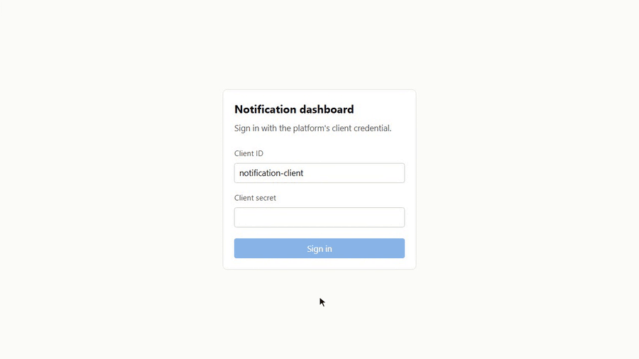
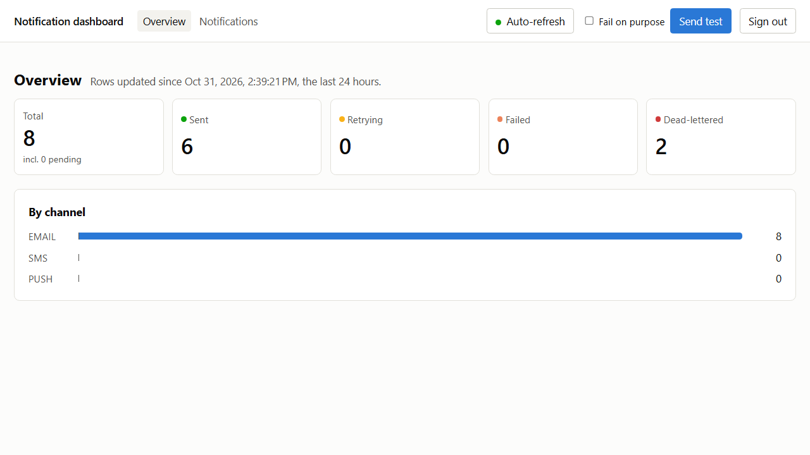
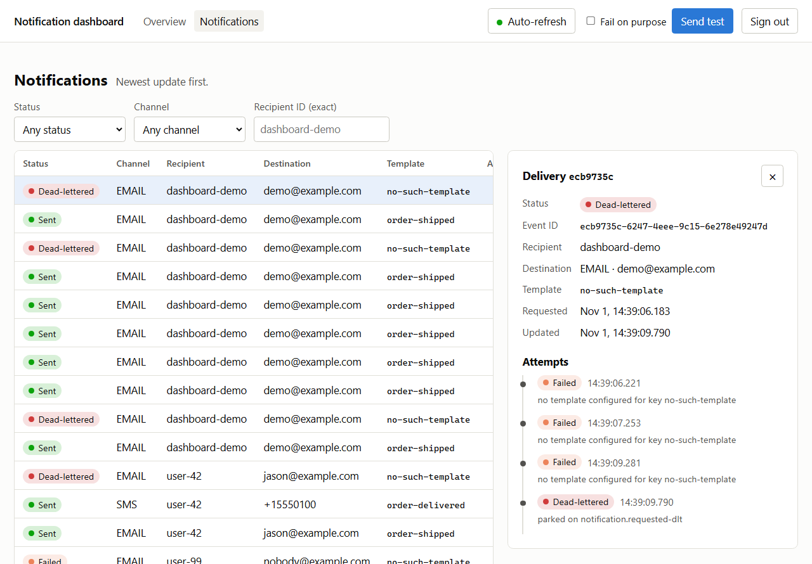
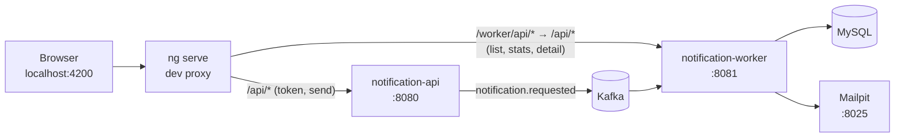

# Notification Dashboard

[](https://github.com/Jason-McKay/notification-dashboard-ui/actions/workflows/ci.yml)

A small Angular 22 dashboard for
[notification-platform](https://github.com/Jason-McKay/notification-platform): sign in, see
the last 24 hours of deliveries by status and channel, send a test notification (or one
built to fail), and watch it move through `PENDING` → `RETRYING` → `DEAD_LETTERED` with its
attempt timeline beside it.

Standalone components, signals, zoneless change detection, no component or state library.

## Screenshots






## How it fits together

The platform splits writes from reads: the api on :8080 takes the token request and the
send, and the worker on :8081 owns the delivery records and serves every read
([backend ADR 0003](https://github.com/Jason-McKay/notification-platform/blob/main/docs/adr/0003-worker-owns-the-schema.md)).
The dev server's proxy puts both behind one origin, so the browser never makes a
cross-origin call and the backend needs no CORS configuration.



Every view polls every 5 seconds while auto-refresh is on and the tab is visible, and
reloads at once after a send.

## Running it

Needs [notification-platform](https://github.com/Jason-McKay/notification-platform) checked
out beside this repo, Docker, and **Node 24** (`.nvmrc` pins 24.18.0, so `nvm use` first):

```bash
docker compose -f ../notification-platform/compose.yaml up --build -d
npm ci
npm start           # http://localhost:4200
```

Sign in with client id `notification-client` and secret `dev-secret`. These are the
backend's public dev placeholders; they are documented here and appear nowhere in the
source.

Port 8080 is also the message-inspector backend's port. Stop that first if it is running.

## Demo

1. **Overview** shows the counts for rows updated in the last 24 hours, with each card
   linking to the list filtered by that status.
2. **Send test** sends an `order-shipped` email to `dashboard-demo`. Follow the `view` link:
   it reaches `SENT` within a second or two, and the rendered mail is waiting in Mailpit at
   http://localhost:8025.
3. Tick **Fail on purpose** and send again. That one names a template that does not exist,
   so the worker tries it three times (waiting 1s, then 2s) and parks it. The panel shows it go
   `RETRYING` and then `DEAD_LETTERED`, with three failed attempts and the dead-letter
   marker in its timeline. `FAILED` lasts well under a second on the way to the dead-letter
   topic, so a 5-second poll usually skips it.
4. Filters, page and the open row all live in the URL, so any view can be linked to.

A 404 for a delivery you have just sent is expected for a moment: the worker writes the row
when it consumes the event, and the panel keeps checking until it does.

## Things this deliberately does not do

- **The client secret is held in the browser.** That is a dev-only stand-in for a real
  identity provider. The platform's token endpoint takes a client id and secret, which is a
  machine-to-machine grant; a real deployment would put a login flow (OIDC with PKCE) in
  front, and the browser would never see a secret.
- **The token lives in memory only**, never in `localStorage` or `sessionStorage`. A page
  reload signs you out. That is the intended cost
  ([ADR 0001](docs/adr/0001-in-memory-token-and-dev-proxy.md)).
- **It runs on the dev server only.** The `/api` and `/worker` routing is `proxy.conf.json`,
  which `ng serve` reads and a production build does not. Deploying it would need a reverse
  proxy (or the platform's gateway, when it exists) doing the same split.

## Testing

```bash
npx ng test --watch=false   # Vitest in jsdom, no browser needed
npm run lint                # angular-eslint: recommended, stylistic, template accessibility
npm run build
```

Specs are behavioural. Components are tested against stubbed services for both success and
HTTP failure, the services against `HttpTestingController` with every URL pinned, and the
refresh timing with fake timers. A routes spec checks that every URL the app navigates to
matches a route.

CI ([`.github/workflows/ci.yml`](.github/workflows/ci.yml)) runs `npm ci`, lint, test and a
production build on every push and pull request to `main`, on the Node version in `.nvmrc`.

## More

- [`CLAUDE.md`](CLAUDE.md): commands, conventions and the gotchas.
- [`docs/adr/`](docs/adr/): this repo's decision records.
- The backend's [decision records](https://github.com/Jason-McKay/notification-platform/tree/main/docs/adr),
  in particular 0003 (why reads come from the worker) and 0005 (the delivery states and the
  read api this dashboard consumes).
